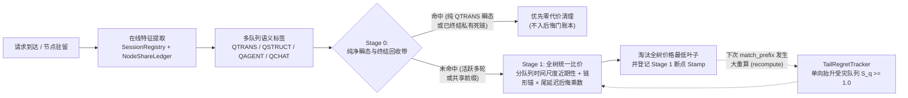

# HeterCache-TTFT：混合负载下基于多队列时间尺度与尾延迟后悔闭环的 KV 缓存淘汰设计

> **文档定位**：下一代 `HeterCache` 策略架构设计规范与论文方法论蓝图
> **代码载体**：`python/sglang/srt/mem_cache/heter_cache/` + `evict_policy.HeterCacheStrategy`
> **优化目标**：在异构混合及动态漂移负载下，**最小化长尾首字延迟（TTFT P90 / P95）与多轮整链丢失率**，同时保持总命中率逼近离线最优（OPT）。

---

## 一、 问题定义与前期实验复盘

### 1.1 物理本质：TTFT P90 由「断链重算峰值」决定，而非平均未命中率

在大模型推理服务中，单次请求的首字延迟可写为：

$$\text{TTFT} = T_{\text{queue}} + \text{Cost}_{\text{prefill}}\bigl(L_{\text{prompt}},\ L_{\text{prompt}} - L_{\text{hit}}\bigr)$$

前期 `tail-stress` 实验表明：`LRU` 与 `OPT` 的总命中率仅相差 `7.2pp`（78.1% vs 85.3%），但 **TTFT P90 相差 4.4 倍**（792ms vs 180ms）。原因在于：
* 将 `12,000` 个未命中 token 均摊到 20 次请求（每次削尾 `600` token），单次仅增加约 `72ms`，完全不会进入 P90；
* 若把某条活跃多轮会话的前缀**从叶到根整条剥穿**（`hit = 0`），单次重算 `12,000` token 直接产生 **`1.44s`** 尖峰，且下一轮重插后在空窗期再次变旧被剥，陷入「整链重算 → 重插 → 再被剥穿」的死循环。

### 1.2 四轮全量实验证伪的三条旧假设

基于 `ec8c33e`、`59b4cae`、`stage0_ablation` 与 `w1new_full` 四轮对比实验，我们从实证数据中明确了原有设计的三处结构性错位：

1. **假设证伪一：平均价值密度 `VD` 与 TTFT P90 目标逆向**
   * `VD_q = H_q / occ_q` 度量的是「单位驻留 token 在窗口内换回的平均命中吞吐」，天然偏向**短间隔、高频、短前缀**流量（如 `agentic` 3s 间隔、`struct` 共享模板）。
   * 而决定 TTFT P90 的恰恰是**长间隔、长私有前缀**的多轮对话（如 `tail-stress` 的 `warm` 45s/12k、`exp3` 的长 `chat`），其单位时间 `VD` 天然最低。
   * `w1new_full` 消融证实：用 `VD` 向下打折保护权重（`scale_min = 0.25`）会将 `warm` 的链形保护罚项砍至 1/4（41s < 45s 空窗），导致 `tail-stress` P90 恶化 **+185ms**（384ms → 569ms）；去掉下折（`scale_min = 1.0`）立即恢复。

2. **假设证伪二：Stage 0 混入固定墙钟 TTL 老化会误杀活跃会话**
   * `drift3`（`bg_2×`）证实：**多队列隔离单轮瞬态流（`QTRANS`）对混合负载至关重要**，使 `chat` 桶命中率达到 **76.70%**（P90 102.3ms），大幅领先无队列隔离的 `chain_lru`（**62.42%** / P90 165.2ms，**+14.28pp**）。
   * 但 `stage0_ablation` 同时揭示：原 `is_one_shot` 把 `chat` 300s / `struct` 120s 的固定 TTL 老化也塞进了 Stage 0，在 `exp3/chat` 上误杀了轮间方差大的活跃会话（扣损 **-2.0pp**），在 `exp3/scan` 上误杀了 `struct` 模板（`struct` 桶 P90 从 39ms 退化至 252ms）。
   * 此外，用 `SessionState.L` 裁剪成长期 `chat` 的 `floor` 会使第 1~3 轮短链（1.5k~4.5k）保护不足，在长成大链前即被剥穿（整链丢失 +8.5pp）。

3. **假设证伪三：按单节点 `span` 记账的后悔率 $R_q$ 被长链稀释**
   * 原 `RegretGate` 在请求 miss 时只按 `matched` 断点处那 **1 个被删叶子的 `span`** 记后悔，而多轮长链往往被连续剥掉 $N$ 个叶子（分母计 $N$ 段之和、分子只 join 1 段），导致长链队列的 $R_{\text{chat}}$ 被稀释数倍，且无法区分「丢 500 tok 的轻度尾截断」与「丢 12k tok 的断链灾难」。

---

## 二、 核心设计哲学与架构总览

### 2.1 多队列在 TTFT 优化中的重新定位

放弃「按平均 `VD` 排出单一牺牲队列」的吞吐导向思路，将多队列（`QTRANS` / `QSTRUCT` / `QAGENT` / `QCHAT`）重新定义为**异构负载的语义解耦层**，承担单队列（如 `chain_lru`）无法完成的三大职能：

1. **冲刷隔离（Admission / Transient Filtering）**：识别并快速排空零复用的单轮瞬态流（`QTRANS`）与已确认终结的死会话残链，防止背景洪峰冲刷多轮前缀。
2. **分队列近期性（Time-Scale Normalized Recency）**：不同队列的「陈旧」不在同一墙钟尺度上（闲置 30s 的 `agentic` 已历时 5× $T_{50}$，而闲置 30s 的 `chat` 仅历时 0.25× $T_{50}$）。通过队列先验与个体 `gaps` 对齐时间尺度，消除高频流对低频长链的系统性 recency 挤压。
3. **分队列拓扑锚与尾延迟后悔闭环（Topology Anchor & Tail-Regret Boost）**：按队列语义定义证据门与锚深，并用面向**大重算事件**的后悔率单向放大受灾队列的保护强度（只放大、不打折）。

### 2.2 两阶段决策流水线

---

## 三、 关键机制与数学定义

### 3.1 Stage 0：纯净瞬态隔离与死链回收（Purified One-Shot Band）

将 Stage 0 严格收敛为「只清确定无复用价值的垃圾，绝不碰未终结会话与高共享模板」：

节点 $n$ 进入 Stage 0 当且仅当满足以下任一条件：
1. **未复用的单轮瞬态节点**：
   $$\text{session\_type}(n) = \text{TRANS} \ \land\ \text{reuse\_count}(n) = 0 \ \land\ \text{share\_of}(n) < \text{share\_min} \ \land\ (t_{\text{now}} - t_{\text{anchor}}) \ge \tau_{\text{idle}}(p)$$
   其中压力自适应豁免窗 $\tau_{\text{idle}}(p)$ 随缓存池可用率 $p = \text{available} / \text{capacity}$ 动态收缩：
   $$\tau_{\text{idle}}(p) = \begin{cases} \tau_{\text{idle,min}} \ (\text{e.g. } 3\text{s}), & p < 0.05 \ (\text{承压期快速排空冲刷}) \\ \tau_{\text{idle,normal}} \ (\text{e.g. } 20\text{s}), & p \ge 0.05 \end{cases}$$
2. **已确认终结的私有会话节点**：
   $$\text{share\_of}(n) < \text{share\_min} \ \land\ \text{reuse\_cross}(n) = 0 \ \land\ \text{session\_expired}(n) = \text{True}$$
   其中 `session_expired` 仅在观测到充足回访间隔（`len(state.gaps) >= min_gaps_ttl`，推荐 `3`）且闲置超过个体寿命上限 $L_{\text{life}} = \text{clip}(k_{\text{ttl}} \cdot \text{p90}(\text{gaps}),\ L_{\min},\ L_{\max})$（推荐 $k_{\text{ttl}}=4.0,\ L_{\min}=180\text{s}$）时触发，避免误杀 ShareGPT 中轮间方差较大的活跃会话。

> [!IMPORTANT]
> **与旧版的关键区别**：移除对 `QCHAT` / `QAGENT` 的固定 `300s` 墙钟 TTL 强行降级，以及对已达标共享 `QSTRUCT` 模板的 `120s` 强行降级；它们的自然新陈代谢全部交由 Stage 1 在全树范围内与其它候选叶子平滑比价决定。

---

### 3.2 分队列近期性：时间尺度对齐（Queue & Session Time-Scale Alignment）

为消除高频短间隔队列（`agentic`）在绝对时间戳 `last_access_time` 上对低频长间隔队列（`chat`）的天然碾压，定义节点 $n$（归属队列 $q$，归属会话状态 $s$）的**特征回访时间尺度 $\tau(n)$**：

$$\tau(n) = \begin{cases} \text{clip}\bigl(\text{median}(s.\text{gaps}),\ 0.5\,\tau_q,\ 3.0\,\tau_q\bigr), & \text{if } s \neq \text{None} \ \land\ |s.\text{gaps}| \ge 2 \\ \tau_q, & \text{otherwise} \end{cases}$$

其中队列先验尺度取自负载统计特征（以 $\tau_{\text{ref}} = \tau_{\text{chat}}$ 为基准参考尺度）：
* $\tau_{\text{chat}} = 120\text{s}$（对应多轮人工交互尺度）；
* $\tau_{\text{agentic}} = 15\text{s}$（对应高频工具调用尺度）；
* $\tau_{\text{struct}} = 120\text{s}$（模板按基准墙钟尺度衰减）。

由此定义**时间尺度归一化后的等效访问时刻 $\tilde{t}_{\text{lat}}(n)$**（保持量纲为「等效秒」，与链形惩罚直接相加）：

$$\tilde{t}_{\text{lat}}(n) = t_{\text{now}} - \frac{\tau_{\text{ref}}}{\tau(n)} \cdot \bigl(t_{\text{now}} - t_{\text{last}}(n)\bigr)$$

* **物理含义**：
  * 对 `chat`（$\tau = 120\text{s}$）：闲置 $45\text{s}$ 等效变旧 $45\text{s}$；
  * 对 `agentic`（$\tau = 15\text{s}$）：闲置 $15\text{s}$ 已历经一个完整周期，等效变旧 $\frac{120}{15} \times 15 = 120\text{s}$！
  * 当 `agentic` 活跃（3s 内刚访问）时，其等效变旧仅 $24\text{s}$，仍受充分保护；一旦 `agentic` 闲置超过十余秒未归，它会比正常空窗期（45s）内的 `chat` 更快出池，从而在不设硬配额的前提下实现**跨队列近期性公平**。
  * 设开关 `time_scale_align: bool`：关闭时 $\tilde{t}_{\text{lat}}(n) \equiv t_{\text{last}}(n)$，便于论文做严格单因素消融。

---

### 3.3 分队列拓扑锚 $\text{anchor}_q(n)$ 与证据门

在统一链形定价中，不同队列依据各自树拓扑使用差异化的证据门与锚深（**不再用 `state.L` 向下截断成长期多轮链**）：

| 队列 $q$ | 保护证据门 `has_evidence(n)` | 有效锚深 $\text{anchor}_q(n)$ | 设计依据 |
|---|---|---|---|
| **`struct`** | $\text{shared\_depth}(n) > 0$（链上存在 `share_of >= share_min` 或 `reuse_cross > 0`） | $\text{shared\_depth}(n)$ | 单轮请求无 `gaps`；精准护住跨会话共享模板本身，不浪费 `8192` 配额保护单轮私有后缀 |
| **`chat`** | `reread_depth > 0` 或 `len(s.gaps) >= 1` | $\max\bigl(\text{floor}_{\text{chat}},\ \text{reread\_depth}(n)\bigr)$（默认 $\text{floor}_{\text{chat}} = 8192$） | 不按 `s.L` 向下截断，确保第 1~3 轮成长期的慢速对话同样享有完整空窗保护 |
| **`agentic`** | `reread_depth > 0` 或 `len(s.gaps) >= 1` | $\max\bigl(\text{floor}_{\text{agentic}},\ \text{reread\_depth}(n)\bigr)$（默认 $\text{floor}_{\text{agentic}} = 8192$） | 护住工具调用长上下文前缀，一旦超过个体寿命则在 Stage 0/锚出口快速释放 |

---

### 3.4 面向尾延迟的后悔闭环 $R_q^{\text{tail}}$（单向放大、绝不打折）

将 `RegretGate` 从「按单叶 `span` 弃权」升级为「**按断链重算代价单向放大保护斜率**」的 `TailRegretTracker`：

1. **写入侧（仅记录 Stage 1 决策）**：
   * Stage 1 淘汰节点 $v$ 时，以其断点页内容键登记 stamp：$\text{key} \mapsto (t_{\text{evict}},\ q,\ \text{span})$，并在滑窗 $W$ 内累加淘汰量 $E_q(W) += \text{span}$。
2. **反馈侧（按真实重算税归因）**：
   * 请求在 `match_prefix`（`count_reuse=True`）发生前缀未完全命中时，设本次重算量为 $\Delta L_{\text{recomp}} = L_{\text{prompt}} - L_{\text{matched}}$。
   * 若 `matched` 处的断点键命中队列 $q$ 的 stamp，则摘除该 stamp，并记入**尾重算后悔量**：
     $$G_{\text{event}} = \begin{cases} \Delta L_{\text{recomp}}, & \Delta L_{\text{recomp}} \ge L_{\text{tail}} \ (\text{默认 } 2048\text{ tok，对应显著 TTFT 劣化}) \\ 0, & \Delta L_{\text{recomp}} < L_{\text{tail}} \ (\text{轻微尾截断不触发尾延迟保护放大}) \end{cases}$$
     滑窗内累加 $G_q(W) += G_{\text{event}}$。
3. **单侧放大乘数 $S_q$（Monotonic Tail Boost）**：
   $$R_q^{\text{tail}} = \begin{cases} \dfrac{G_q(W)}{E_q(W)}, & E_q(W) \ge E_{\min} \ (\text{默认 } 4096) \\ 0, & \text{otherwise} \end{cases}$$
   $$S_q = \text{clip}\Bigl(1.0 + \beta \cdot R_q^{\text{tail}},\ \mathbf{1.0},\ S_{\max}\Bigr) \qquad (\text{默认 } \beta = 1.0,\ S_{\max} = 4.0)$$

> [!TIP]
> **为什么下界锁死为 `1.0`？**
> 基线链形惩罚 `weight × (anchor - remain)` 是保护多轮前缀不被剥穿的安全底线。没有任何后悔发生时 $S_q = 1.0$；一旦某队列（如 `warm` / `chat`）因淘汰引发大面积断链重算（$\Delta L_{\text{recomp}} \gg \text{span}$），$R_q^{\text{tail}}$ 会迅速放大（可 $>1.0$），将 $S_q$ 推高至 $2\sim 4\times$，自动阻断「剥穿 → 重插 → 再剥穿」的正反馈死循环，而绝不会反过来削弱任何队列的基线保护。

---

### 3.5 Stage 1 全树统一定价总式

综合 3.2–3.4，Stage 1 对全树所有可淘汰叶子 $n \in \mathcal{L}$ 计算单一可比排序键（取 `min` 淘汰）：

$$\text{key}(n) = \Bigl(\tilde{t}_{\text{lat}}(n) + \mathbb{I}[\text{valid}(n)] \cdot S_q \cdot w \cdot \max\bigl(0,\ \text{anchor}_q(n) - \text{remain}(n)\bigr),\ -\text{remain}(n),\ \text{id}(n)\Bigr)$$

其中 $\mathbb{I}[\text{valid}(n)]$ 在 `has_evidence(n)` 为真且路径未全部 `session_expired` 时为 $1$，否则为 $0$。

---

## 四、 代码模块落地与清理清单

遵循仓库已确立的不变量（`record_evict` 早于 `free_segment`、`SessionProbe.on_charge` 早于截断、`_observe_occupancy` 单次遍历两用）：

| 模块路径 | 计划改动 |
|---|---|
| `heter_cache/utils.py` | 1. 收敛 `ShareParams`：默认关闭 `chat`/`struct` 固定墙钟 TTL 强行入 `one_shot`，默认采用保守 `session_life`（`k=4.0, min_s=180, min_gaps=3`）；增加承压动态 `ONE_SHOT_IDLE_S`。 2. 更新 `RegretGateParams`：`scale_min=1.0`（移除 `VD` 乘数 `alpha` 控制路径，保留 `VD` 仅供 telemetry 观测对拍）、新增 `tail_recompute_min: int = 2048`、`time_scale_align: bool = True`、`tau_by_queue: Dict[str, float]`。 |
| `heter_cache/regret_gate.py` | `on_request` 接收 `recompute: int = 0`；当 `recompute >= tail_recompute_min` 时按 `recompute` 累加尾重算后悔窗口（保留兼容 `recompute=0` 回退 `span` 以兼容旧单测）。 |
| `heter_cache/radix_cache.py` | `_record_match_regret` 将已算出的 `recompute = prompt - matched` 透传给 `gate.on_request(key=breakpoint_key, recompute=recompute)`；Stage 0 继续隔离不写 `rgate`。 |
| `heter_cache/override.py` | 1. `chain_leaf_key` 移除 `cap_floor_by_session_L` 对 `chat` 的截断，新增可选 `effective_lat`（时间尺度对齐）。 2. `PricedFallback.queue_scales` 只计算单向放大 $S_q = \text{clip}(1 + \beta R_q^{\text{tail}}, 1.0, S_{\max})$。 3. 清理已成为死路径的队内 `ReuseScoreEvict` / `ChainEvict` 选点分支（或仅留作显式离线对照）。 |
| `heter_cache/selector.py` | Stage 0（纯净 `is_one_shot`） → Stage 1（统一软定价器），精简废弃的串行 `queue_order` 弃权跳转分支。 |

---

## 五、 论文实验与阶梯消融矩阵（Ablation Study）

为清晰呈现多队列每一层机制的独立贡献，论文评测按以下 6 个阶梯展开（统一在修复虚拟时钟同步后的同源环境下评测）：

| 编号 | 策略变体 | 启用机制 | 主要验证假设与目标靶点 |
|---|---|---|---|
| **B0** | `LRU` / `FIFO` / `LFU` / `SLRU` | 单队列经典启发式 | 展示混合负载下频次策略饿死多轮新会话（`exp3/chat` ~15%/32%）、`LRU` 整链剥穿（`tail-stress` P90 792ms） |
| **B1** | `Chain-LRU`（全局单队列链形保护） | 静态 `lat + w·(floor - remain)` | 验证微观链形保护降低 `tail-stress` P90，但暴露无队列隔离在 `drift3`（`bg_2×`）下被单轮 `trans` 冲刷击穿的短板 |
| **M1** | `+ Purified Stage 0`（纯净瞬态隔离） | B1 + 仅隔离 `QTRANS` 与确认终结死链 + `struct` `shared_depth` 锚 | 验证在不伤及 `exp3/chat` 与 `exp3/scan` 模板的前提下，赢回 `drift3` 强背景冲刷下的显著优势 |
| **M2** | `+ Queue Time-Scale Recency`（分队列近期性） | M1 + 队列/会话周期归一化 $\tilde{t}_{\text{lat}}(n)$ | 验证高频 `agentic` 与低频 `chat` 混跑时，按交互周期归一化陈旧度对长间隔会话命中率与 P90 的提升 |
| **M3** | **HeterCache-TTFT（完整方案）** | M2 + 尾延迟重算后悔单向放大 $S_q(R_q^{\text{tail}}) \ge 1.0$ | 验证在极端长尾竞争（`tail-stress`）与负载突变（`drift3` 相位切换）下自适应强化受灾队列保护，逼近 `OPT` |
| **Oracle** | `OPT`（Belady 固定点上界） | 离线未来精确下次使用时刻 | 给出物理容量下的理论命中率与 TTFT P90 天花板 |

### 验收成功判据（Gate Criteria）
1. **`tail-stress`**：TTFT P90 $\le 380\text{ms}$（优于 `Chain-LRU` 的 386ms，大幅优于原 `HeterCache` 的 616ms），`warm` 整链丢失率 $\le 22\%$。
2. **`drift3`（`bg_1×` / `bg_2×`）**：总命中率与 `P2 chat` 桶命中率保持领先 `Chain-LRU` $\ge +2.5\text{pp}$（`chat` 桶领先 $\ge +12\text{pp}$）。
3. **`exp3` 四 cell**：在同一虚拟时钟口径下，`scan` / `struct` / `agentic` / `chat` 四格全面追平或反超 `Chain-LRU`（其中 `scan` 的 `struct` 桶命中率恢复至 $\ge 94\%$）。
