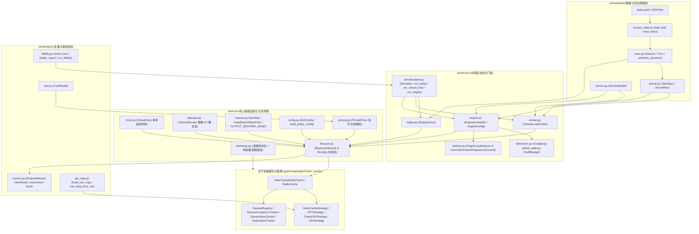
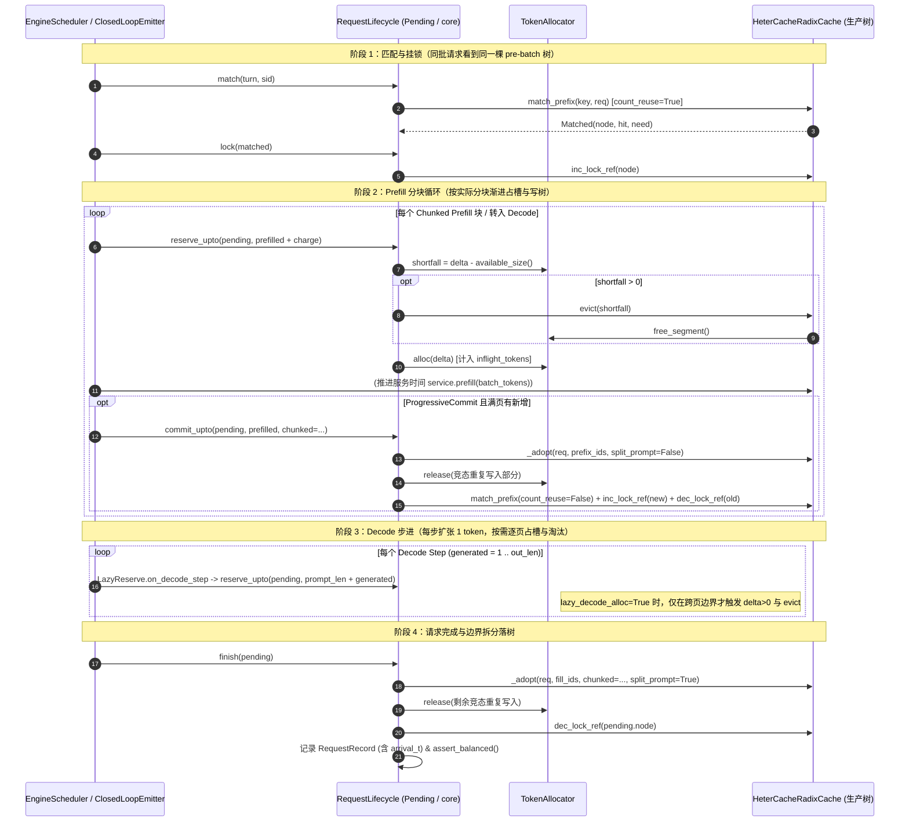
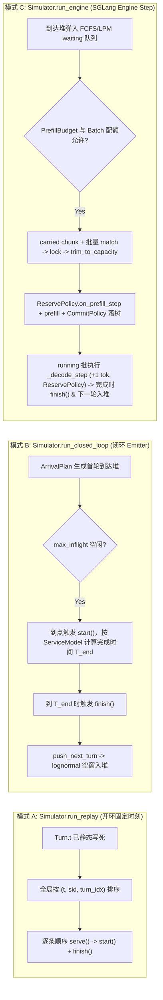

# RadixCacheSim 离线前缀缓存模拟器设计与使用指南 (`RadixCacheSim.md`)

本文档详细介绍 `/home/rain/MySglang/sim/`（简称 **RadixCacheSim**）离线前缀缓存模拟器，内容分为三个部分：
1. **模拟器整体结构**：设计定位、架构拓扑、模块职责矩阵与核心保真不变量。
2. **仿真执行 Pipeline**：从数据读取、单请求增量 KV/写树状态机，到三种调度模式（开环回放 / 闭环发射 / SGLang 步级引擎调度）及 OPT 上界生成流水线。
3. **启动方式与自动化脚本**：内置 CLI 自检与保真对拍、核心参数速查表，以及可直接运行的端到端对比压测仿真脚本（Bash + Python）。

---

## 第一部分：模拟器整体结构

### 1.1 设计定位与核心理念

在验证 `HeterCache`、`ChainLRU`、`OPTStrategy` 等前缀缓存淘汰策略时，如果每次调参或消融实验都启动真实 SGLang GPU 服务，单次长负载测试往往耗时数十分钟且依赖多卡显存。`sim/` 的核心设计目标是：**在纯 CPU 环境下，不复制任何一行策略逻辑，直接导入并驱动生产环境 `python/sglang/srt/mem_cache/` 的真实前缀缓存与策略代码**。

相比“另写一套简化玩具模拟器”，RadixCacheSim 坚持四项原则：
1. **生产代码零复制**：`HeterCacheRadixCache`、`RadixCache`、`TreeNode`、`HeterCacheStrategy`、`QueueOccupancyTracker`、`QueueValueTracker`、`SessionRegistry`、`ReuseScoreEvict`、`ChainLRUStrategy`、`RegretGate`、`OPTStrategy` 全部直接从 `python/sglang/srt/mem_cache/` 导入执行。
2. **虚拟时钟推进**：将 Wall Clock 替换为事件驱动的单调虚拟时钟 `VirtualClock`
3. **物理槽位严格守恒**：用整数级 `TokenAllocator` 替代 GPU KV Page Pool，严格执行先按短缺淘汰，再物理占槽的顺序契约，绝不静默超配。
4. **阶梯式引擎保真**：在闭环多轮负载下，支持与线上 `bench_heap.py` 一致的并发到达模型，也支持 SGLang `Scheduler` 级别的 `EngineSimulator`（批预算控制、`chunked_prefill` 分块交错、按步物理分配 KV 槽位与渐进式增量写树）。

---

### 1.2 整体架构拓扑



---

### 1.3 目录模块职责矩阵

`/home/rain/MySglang/sim/` 重构后拆分为 `core/`、`workload/`、`drivers/`、`analysis/` 四个子包与入口门面：

| 子包 / 模块 | 核心类 / 函数 | 职责说明 |
|---|---|---|
| [`simulator.py`](file:///home/rain/MySglang/sim/simulator.py) / [`__init__.py`](file:///home/rain/MySglang/sim/__init__.py) | `Simulator`, `run_synthetic()` | 对外薄门面，提供 `run_replay`、`run_closed_loop`、`run_engine`、`result()` 入口，并暴露 `lifecycle`、`cache`、`alloc`、`clock` 属性。 |
| [`selfcheck.py`](file:///home/rain/MySglang/sim/selfcheck.py) / [`__main__.py`](file:///home/rain/MySglang/sim/__main__.py) | `main()` | `python -m sim` 环境自检入口，聚焦环境装载、最小回路（match→insert→evict）及虚拟时钟边界三段验证。 |
| [`core/bootstrap.py`](file:///home/rain/MySglang/sim/core/bootstrap.py) | `load()`, `stubs()`, `status()` | CPU 环境导入隔离层。真模块优先；仅捕获 `ImportError` 时才为 `memory_pool` 和 `metrics_collector` 挂载替身。 |
| [`core/clock.py`](file:///home/rain/MySglang/sim/core/clock.py) | `VirtualClock` | 可步进的单调虚拟时钟，通过 `CacheInitParams.now` 注入生产 `RadixCache` 及其下属组件。 |
| [`core/allocator.py`](file:///home/rain/MySglang/sim/core/allocator.py) | `TokenAllocator`, `OutOfTokens`, `tree_tokens()` | KV 槽位计数池。回答 `size`、`device`、`available_size()`、`free_segment()`，超配或二次释放立即报错。 |
| [`core/request.py`](file:///home/rain/MySglang/sim/core/request.py) | `SimReq`, `SimKv`, `FakeReqToTokenPool`, `OUTPUT_SENTINEL_BASE` | 生产缓存所需的最小请求替身；无真实 `response_ids` 时分配 `1 << 30` 起步的独占哨兵。 |
| [`core/config.py`](file:///home/rain/MySglang/sim/core/config.py) | `SimConfig`, `build_policy_config()` | 仿真可调配置及不同策略族的配置字典生成。 |
| [`core/pricing.py`](file:///home/rain/MySglang/sim/core/pricing.py) | `PromptPricer` | 按页预构建块代价前缀和数组，快速计算每请求的 `total_cost` 与 `saved_cost`。 |
| [`core/lifecycle.py`](file:///home/rain/MySglang/sim/core/lifecycle.py) | `Matched`, `Pending`, `RequestLifecycle` | 单请求生命周期原语（`prepare`、`match`、`lock`、`new_pending`、`admit`、`admit_locked`、`start`、`reserve_upto`、`commit_upto`、`finish`、`serve`）及池账守恒断言。 |
| [`workload/trace.py`](file:///home/rain/MySglang/sim/workload/trace.py) | `Turn`, `Session`, `max_total_len()`, `synthetic_sessions()` | Trace 数据结构及四类会话混合合成负载生成器。 |
| [`workload/session_data.py`](file:///home/rain/MySglang/sim/workload/session_data.py) | `load_task()`, `load_tasks()` | 与 `bench_heap.py` 对齐的数据集读取器（完整 `input_ids`、真实 `response_ids`、上一轮 `tool_call`、`min_turns`）。 |
| [`workload/service.py`](file:///home/rain/MySglang/sim/workload/service.py) | `ServiceModel` | 线性 Prefill/Decode 服务时长模型，支持 `from_calibration()` 导入真机标定速率。 |
| [`workload/arrival.py`](file:///home/rain/MySglang/sim/workload/arrival.py) | `TaskSpec`, `ArrivalPlan`, `first_turn_offsets()`, `stable_seed_from_str()` | 到达流（`poisson` / `fixed` / `segments`）、轮间对数正态等待 RNG 与统一的堆构建/推进计划。 |
| [`drivers/replay.py`](file:///home/rain/MySglang/sim/drivers/replay.py) | `ReplayDriver` | 无并发开环静态时间序列回放驱动。 |
| [`drivers/emitter.py`](file:///home/rain/MySglang/sim/drivers/emitter.py) | `ClosedLoopEmitter` | 闭环多轮发射器，复刻 `bench_heap.py` 并发控制（`max_inflight`）。 |
| [`drivers/engine.py`](file:///home/rain/MySglang/sim/drivers/engine.py) | `EngineConfig`, `EngineScheduler` | 复刻 SGLang 步级 Prefill/Decode 批调度器主循环。 |
| [`drivers/admission.py`](file:///home/rain/MySglang/sim/drivers/admission.py) / [`budget.py`](file:///home/rain/MySglang/sim/drivers/budget.py) | `QueuedTurn`, `ActiveReq`, `admit_waiting()`, `trim_to_capacity()`, `PrefillBudget` | 等待队列排序（`fcfs`/`lpm`）、批量准入扫描、在途未占槽未来余量核扣与上锁后二次容量裁剪。 |
| [`drivers/policies.py`](file:///home/rain/MySglang/sim/drivers/policies.py) / [`common.py`](file:///home/rain/MySglang/sim/drivers/common.py) | `ReservePolicy`, `CommitPolicy`, `pct()`, `build_emit_stats()` | 将按步占槽（`EagerReserve`/`LazyReserve`）与渐进写树（`CommitOnFinish`/`ProgressiveCommit`）抽象为可插拔策略对象，共用分位数与 emit 汇总。 |
| [`analysis/opt_map.py`](file:///home/rain/MySglang/sim/analysis/opt_map.py) | `build_use_map()`, `use_map_from_run()`, `write_use_map()` | 复用生产同源哈希生成 OPT 未来使用时刻表。 |
| [`analysis/cost.py`](file:///home/rain/MySglang/sim/analysis/cost.py) | `CostModel` | 块级重算代价模型（独立于驱动层与核心层）。 |
| [`analysis/metrics.py`](file:///home/rain/MySglang/sim/analysis/metrics.py) | `RequestRecord`, `SimResult`, `summarize()` | 逐请求记录（含 `arrival_t` 到点时刻）、复现 SHA1 指纹、时间轴冻结与 JSONL 输出。 |
| [`analysis/fidelity.py`](file:///home/rain/MySglang/sim/analysis/fidelity.py) | `check_tree()`, `ledger_report()`, `run_fidelity()` | 压力 trace 拓扑不变量校验与增量账本对拍工具。 |

## 第二部分：仿真执行 Pipeline

### 2.1 数据加载与会话构造 Pipeline

离线加载由 [`sim/workload/session_data.py`](file:///home/rain/MySglang/sim/workload/session_data.py) 负责，规则与真机压测脚本 [`bench_heap.py`](file:///home/rain/MySglang/Heter-Bench/scripts/bench_heap.py) 完全对齐：

1. **逐行解析会话 JSONL**：读取 `{"<session_id>": {"id": ..., "num_turns": N, "turn_1": ..., ...}}`，若 `shuffle=True` 则使用 `random.Random(seed + task_id)` 打乱顺序，再执行 `max_record` 截断。若配置了 `min_turns`（例如 `5`），则过滤保留满足 `num_turns >= min_turns` 的会话，避免多轮对话因短样本被 `SessionRegistry` 误判为 `TRANS`（one-shot 带）。
2. **完整历史 Prompt**：直接读取 `turn_i.input_ids` 作为 `Turn.prompt`，避免客户端自己拼接时遗漏模型特有的 Chat Template 特殊 token，保证与服务端真实收到的数据完全一致。
3. **Response Token 处理（双分支机制）**：
   - **真实数据回放（推荐）**：当数据集包含 `turn_i.response_ids` 时，存入 `Turn.response`。因为第 $k+1$ 轮的完整 prompt 正是「第 $k$ 轮 prompt + 第 $k$ 轮 response + 新消息」，只有把真实 `response_ids` 写入树中，下一轮访问时才能正确命中上一轮生成出的 KV 段。
   - **无 Token 合成负载回退**：若 trace 只给出生成长度 `out` 而无 `response_ids`，[`SimReq`](file:///home/rain/MySglang/sim/core/request.py#L37-L90) 会为每个请求分配独占的虚拟哨兵 token：`OUTPUT_SENTINEL_BASE + rid_seq`（即 `2^30 + rid_seq`），既防止不同请求的生成内容意外碰撞产生假命中，又严格控制在 C++ `checked_u32` 与 `array("i")` 的安全范围之内。
4. **`tool_call` 取上一轮标志**：对齐 `bench_heap.py` 的 payload 规则，第 `idx` 轮请求的 `tool_call` 取自 `turn_{idx-1}.tool_call`（第 1 轮恒为 `False`），用以在 Prefill 阶段触发 Agentic 分类证据。
5. **超大请求保护（`oversize`）**：当单条请求所需新增槽位 `need` 大于总容量 `alloc.size`（或锁满无法腾出空间）时，默认 `oversize="error"` 直接抛出 `OutOfTokens`；设置 `oversize="skip"` 则跳过落树，单独计入 `skipped_requests`，不污染 `hit_rate` 分母。

---

### 2.2 单请求生命周期与增量 KV/写树状态机

为了消除准入时预留全部输出、请求完成时一次性写树带来的水位偏高与并发可见延迟问题，[`RequestLifecycle`](file:///home/rain/MySglang/sim/core/lifecycle.py) 提供了细粒度的增量生命周期原语，由 `EngineScheduler` 与 `ReservePolicy`/`CommitPolicy` 在每个 engine step 中逐步推进：



#### 核心原语详解

1. **`match(turn, session_id, ...)`**：
   - 将 `VirtualClock` 推进到 `turn.t`，若 `turn_idx >= 0` 则记录派发时间到 `_dispatched[(session_id, turn_idx)]`。
   - 声明 `req.kv.cache_protected_len = len(req.fill_ids())`（树引用语义：结束时由 `RequestLifecycle` 统一对账，不让 `_adopt` 额外减扣非对称请求行）。
   - 对 `turn.prompt` 做 `page_size` 对齐后调用 `cache.match_prefix(count_reuse=True)`：触发 `SessionRegistry.observe_request`、计数 `reuse_count` 递增与 `CacheTelemetry.on_hit` 打点。
   - 计算全序列 `prompt + response` 页对齐长度与已命中 `hit` 的差值 `need = total - hit`，但不挂锁、不淘汰、不占槽。
2. **`lock(matched)`**：
   - 调用 `cache.inc_lock_ref(matched.node)` 将已命中祖先链移出 `evictable_leaves`，保证批内后续请求引起的淘汰不会踢掉已批复请求的前缀。
3. **`reserve_upto(pending, seq_len)`**（[`lifecycle.py`](file:///home/rain/MySglang/sim/core/lifecycle.py)）：
   - 计算目标占槽长度 `target = min(ceil(seq_len / page) * page, pending.hit + pending.need)`，得出本次物理槽位增量 `delta = target - pending.allocated_len`。
   - 当 `delta > 0` 时，检查 `shortfall = delta - alloc.available_size()`；若不足则触发 `cache.evict(shortfall)`，再执行 `alloc.alloc(delta)`，并将 `delta` 累加入 `self.inflight_tokens`。
   - 开启 `lazy_decode_alloc=True`（`LazyReserve`）后，长输出请求的未来 `output` token 不会在 Prefill 准入瞬间占满显存池，而是随着 `decode_step` 跨过 `page_size` 边界才逐页推进淘汰，显存压力波形与真机一致。
4. **`commit_upto(pending, seq_len, chunked=...)`**（[`lifecycle.py`](file:///home/rain/MySglang/sim/core/lifecycle.py)）：
   - 将已算完的满页长度截断到已分配边界内，计算未落树增量 `delta = commit_len - pending.committed_len`。
   - 调用生产 `cache._adopt(req, fill_ids[:commit_len], chunked=chunked, split_prompt=False)` 将这部分已算完前缀提前写入 RadixTree，使并发或后续请求立即可见并命中。
   - 通过两次 `tree_tokens(cache)` 差值计算真实增长 `grew`。若等待/并发期间别的请求已先行写入同一前缀（竞态重复 `grew < delta`），立刻通过 `alloc.release(delta - grew)` 归还多预留的槽位，并记入 `duplicate_insert_tokens`。
   - **平稳移锁**：用 `match_prefix(radix_key, count_reuse=False)`（不虚增 `reuse_count`）找到新叶子 `new_node`，先 `inc_lock_ref(new_node)` 再 `dec_lock_ref(pending.node)`，保证锁不断档。
5. **`finish(pending)`**（[`lifecycle.py`](file:///home/rain/MySglang/sim/core/lifecycle.py)）：
   - 将残余未提交片段通过 `cache._adopt(req, req.fill_ids(), chunked=(committed_len > hit), split_prompt=True)` 完成落树；最后一步强制传 `split_prompt=True`，确保 `prompt` 与 `response` 段在 RadixTree 上断开。
   - 释放残留重复槽位并调用 `cache.dec_lock_ref(pending.node)` 解锁，校验 `assert_balanced()` 后按完成序写入 `RequestRecord`（附带 `arrival_t`）。

---

### 2.3 三种运行模式 Pipeline 对比

`Simulator` 提供三种层级的驱动入口，满足从轻量单元测试到高精度 SGLang 引擎逼近的不同实验需求：



| 对比维度 | 模式 A：`run_replay(sessions)` | 模式 B：`run_closed_loop(...)` | 模式 C：`run_engine(...)` |
|---|---|---|---|
| **到达时间生成** | 静态读取 trace 中的 `Turn.t`（开环） | 首轮按 `TaskSpec`，下一轮按 `finish + wait`（闭环） | 首轮按 `TaskSpec`，下一轮按 engine `decode` 完成时刻 + `wait`（闭环） |
| **并发与排队控制** | 无并发（`inflight` 恒为 1） | `max_inflight`（0 不限 / 1 串行 / $k$ 上限） | SGLang 步级准入预算：`max_prefill_tokens`、`chunked_prefill_size`、`max_running_requests`、`max_prefill_bs`、`schedule_policy="fcfs"\|"lpm"` |
| **前缀批内可见性** | 逐条写完再看下一条 | 同刻到达各自 `start()` 互不可见 | 同批 prefill 请求统一先 `match` 再上锁淘汰，互不可见；随后通过 `ProgressiveCommit` 分块/转 decode 后对下一批可见 |
| **物理显存占槽方式** | 一次性预留 `need` | 到点瞬间预留 `prompt + out` 全量 `need` | `LazyReserve`（`lazy_decode_alloc=True`）下：chunk 内按分块占槽，decode 阶段随 `generated += 1` 逐页按需占槽与触发淘汰 |
| **适用场景** | 拓扑保真校验、固定时间序列快速调试 | 对齐 `bench_heap.py` 无批限制的理想闭环发包流 | **最贴近真机 SGLang Server 的消融对比与离线策略调参** |

> [!IMPORTANT]
> **`PrefillBudget` 防死锁安全检查（`drivers/budget.py`）**：开启 `lazy_decode_alloc=True` 后，正在运行 decode 的请求仅占用已生成长度的物理槽位，尚未占用后续 `output` 的残余空间。若批准入忽略这部分未来开销，running 请求同时走到序列尾部时可能陷入全锁死锁。因此 `PrefillBudget` 在每次计算剩余容量时，都会通过 `unallocated_reserved(running, chunked)` 提前扣除在途请求尚未分配的未来配额；同时 `trim_to_capacity` 会在整批上锁移除自身可淘汰前缀后二次复核容量并把超额尾部请求退回 `waiting` 队列。

---

### 2.4 服务时长模型与 Block 计算代价模型

1. **`ServiceModel`**（[`sim/workload/service.py`](file:///home/rain/MySglang/sim/workload/service.py)）：
   - 全程总耗时公式（`run_closed_loop` 用）：
     $$T_{\text{service}} = \text{prefill\_base\_s} + \frac{\text{prompt\_tokens}}{\text{prefill\_tokens\_per\_s}} + \frac{\text{out\_tokens}}{\text{decode\_tokens\_per\_s}}$$
   - 步级拆解（`run_engine` 用）：
     - Prefill Forward 耗时：`prefill_base_s + batch_extend_tokens / prefill_tokens_per_s`（注意 `batch_extend_tokens` 按整批未命中 extend token 累加）。
     - Decode Step 耗时：恒定 TPOT `1.0 / decode_tokens_per_s`。
   - 通过 `ServiceModel.from_calibration(calib_json_path, decode_tokens_per_s=40.0)` 可直接导入 `Heter-Bench/tools/calibrate.py` 测得的 `ttft_intercept_ms` 与 `prefill_rate_tok_per_s`。
2. **`CostModel`**（[`sim/analysis/cost.py`](file:///home/rain/MySglang/sim/analysis/cost.py)）：
   - 用于计算深层 Attention Prefill 成本加权指标 `compute_saving_ratio`（`saved_cost / total_cost`）：
     - `"uniform"`（默认）：每块代价 1，等价于 `hit_rate`。
     - `"position"`：第 $p$ 块代价 $1 + p$。
     - `"linear:A,B"`：第 $p$ 块代价 $A + B \cdot p$。
     - `"qwen3coder30b_blksz_16"`：预设 `linear:865,2`。
     - `"table:FILE"`：从文件逐行读取每位置整数代价。

---

### 2.5 OPT 离线理论上限两阶段 Pipeline

`eviction_policy="opt"` 使用 Belady 未来最近使用时间表作为所有在线策略的天花板。然而在闭环模式（`run_closed_loop` / `run_engine`）中，从数据集加载出来的 `Turn.t` 全为 `0.0`，真实请求派发时刻是在仿真过程中随排队和延迟动态产生的。直接调用 `build_use_map(sessions)` 会得到全零时间轴，导致 `OPTStrategy` 把所有块误判为「再也不使用」。

正确的两阶段（或不动点迭代）生成流程如下：
1. **阶段 1（跑基准拿到时间轴）**：先用任意在线策略（通常为 `lru`）跑一遍完整仿真（注意需设 `oversize="skip"` 时与表容量过滤对齐）：
   ```python
   base_res = Simulator(SimConfig(capacity=CAP, page_size=PAGE, eviction_policy="lru", oversize="skip")).run_engine(
       sessions, specs, scheduler=engine, service=service
   )
   ```
2. **阶段 2（冻结派发时刻并造表）**：调用 `use_map_from_run(base_res, live_sessions, page_size=PAGE)`：
   - 内部先通过 `base_res.freeze_sessions(...)` 将本次运行记录的 `_dispatched[(sid, idx)]` 回写进 `Turn.t`；
   - 再带 `with_response=True` 与 `base_res.response_tokens()` 逐页调用生产同源哈希 `get_storage_hash_str`，将 prompt 与 response 页的全部未来使用时刻写入 JSON。
3. **阶段 3（同轴重放或不动点收敛）**：
   - 若对比纯静态时间轴，可直接用 `Simulator(..., eviction_policy="opt", opt_use_map=...).run_replay(base_res.freeze_sessions(sessions))`；
   - 若在 `EngineScheduler` 下希望连排队引起的微小时间偏移也完全对齐，可像 [`drift3_run.py`](file:///home/rain/MySglang/Heter-Bench/mixexp/tools/drift3_run.py) 那样迭代 1~3 轮直到连续两次 `dispatched` 时间差归零。

---

## 第三部分：启动方式与自动化脚本

### 3.1 内置 CLI 自检与测试命令

在仓库根目录 `/home/rain/MySglang` 下执行以下命令可验证 `sim` 运行环境装配、最小回路、虚拟时钟边界与全套回归测试：

```bash
cd /home/rain/MySglang

# 1. 运行全套环境自检（装载 / 最小回路 / 虚拟时钟边界，全部 OK 后返回 exit code 0）
PYTHONPATH=. python3 -m sim

# 2. 仅验证依赖隔离替身与生产模块导入符号表
PYTHONPATH=. python3 -m sim --import-only

# 3. 保留生产策略内部的 [HeterCache profile] 日志输出（默认 quiet 抑制）
PYTHONPATH=. python3 -m sim --verbose

# 4. 运行单元测试（包含黄金快照、保真、并发、引擎分块、按步分配、OPT、决定性指纹等）
PYTHONPATH=$PWD:$PWD/python python3 -m pytest -q test/manual/test_sim_*.py
```

> [!NOTE]
> `python -m sim` 需要 `torch`（仅使用 CPU tensor）与 `msgspec`。若系统默认 Python 缺少这两个包，请替换为项目中可用的 Conda / 虚拟环境 Python 路径（环境变量可通过下文的 `PY=/path/to/python` 指定）。

---

### 3.2 核心配置参数速查表

#### 1. `SimConfig`（[`sim/core/config.py`](file:///home/rain/MySglang/sim/core/config.py)）

| 参数名 | 默认值 | 说明 |
|---|---|---|
| `capacity` | `4096` | KV Cache 物理容量总 token 数（对齐服务端 `--max-total-tokens`） |
| `page_size` | `1` | 前缀树页大小（如 `1`、`8`、`16`；使用 OPT 时须与 `use_map` 相同） |
| `eviction_policy` | `"heter_cache"` | 策略名：`heter_cache` / `lru` / `chain_lru` / `opt` / `slru` 等生产策略 |
| `value_horizon_s` | `120.0` | HeterCache 价值密度（VD）共用未来视野 $H$（秒） |
| `value_smoothing_k` | `4.0` | VD 速率平滑系数 $k$（推定窗 $W_q = \max(H, k \cdot T_{50,q})$） |
| `value_floor_tokens` | `0.0` | VD 分母占用下限平滑值 |
| `ageing_mode` | `"queue_ttl"` | 老化模式：`"queue_ttl"`（固定 TTL）或 `"session_life"`（按会话自身间隔分布动态判定） |
| `chain_policy` | `None` | 透传 `ChainParams` 字典，开启 `chat`/`agentic` 队内链形后缀保护 |
| `regret_gate` | `None` | 透传 `RegretGateParams` 字典（例如开启后悔弃权门与 `priced_fallback`） |
| `policy_config` | `None` | 当策略需要自定义全套 dict 时原样透传（如 `chain_lru` 参数） |
| `opt_use_map` | `None` | `eviction_policy="opt"` 时的 `use_map.json` 路径 |
| `cost_model` | `"uniform"` | Prefill 重算代价模型，支持 `position` / `linear:A,B` / `qwen3coder30b_blksz_16` 等 |
| `oversize` | `"error"` | 单请求超池容量或锁满无法腾槽时的行为：`"error"` 抛异常，`"skip"` 跳过落树并单独计数 |
| `seed` | `0` | 策略随机种子 |

#### 2. `EngineConfig`（[`sim/drivers/engine.py`](file:///home/rain/MySglang/sim/drivers/engine.py)）

| 参数名 | 默认值 | 说明 |
|---|---|---|
| `max_prefill_tokens` | `16384` | 单步最大 prefill extend token 预算（软上限，对齐 `--max-prefill-tokens`） |
| `chunked_prefill_size` | `-1` | Chunked Prefill 切分大小；`-1` 表示关闭，常用如 `4096` 或 `8192` |
| `max_running_requests` | `None` | 最大并发 running+chunked 请求数上限；`None` 表示不限 |
| `max_prefill_bs` | `None` | 单步 prefill 批大小上限 |
| `schedule_policy` | `"fcfs"` | 等待队列调度序：`"fcfs"`（先到先服务）或 `"lpm"`（最长前缀匹配优先） |
| `progressive_cache` | `True` | `True`（`ProgressiveCommit`）：在每个 chunk 结束及转入 decode 时提前落树移锁；`False`（`CommitOnFinish`）：回退至完成时一次性 `_adopt` |
| `lazy_decode_alloc` | `True` | `True`（`LazyReserve`）：仅按已算前缀与每 decode 步增量占槽并触发淘汰；`False`（`EagerReserve`）：准入时一次性预留全部 `prompt+output` |

---

### 3.3 端到端对比启动脚本模板（可直接保存复用）

下面提供一组通用的离线多策略对比脚本**参考模板**（先保存 Python 驱动，再保存配套 Bash 启动脚本；若需直接使用仓库现成实验脚本，见第 3.4 节）。

#### 第一步：保存通用仿真运行脚本（建议保存为 `Heter-Bench/scripts/sim_eval.py`）

```python
#!/usr/bin/env python3
"""通用 RadixCacheSim 多策略离线对比脚本（基于 EngineScheduler）。"""

import argparse
import json
import pathlib
import sys
import time
import yaml

REPO_ROOT = pathlib.Path(__file__).resolve().parents[2]
sys.path.insert(0, str(REPO_ROOT))
sys.path.insert(0, str(REPO_ROOT / "python"))

from sim import (
    EngineConfig,
    ServiceModel,
    SimConfig,
    Simulator,
    TaskSpec,
    load_tasks,
)
from sim.analysis.opt_map import use_map_from_run, write_use_map


def parse_args():
    ap = argparse.ArgumentParser(description="RadixCacheSim 多策略对比工具")
    ap.add_argument("--tasks-config", required=True, help="tasks.yaml 路径")
    ap.add_argument("--base-dir", default=str(REPO_ROOT / "Heter-Bench"), help="data_path 基准目录")
    ap.add_argument("--arms", default="lru,heter_cache,opt", help="逗号分隔的对比策略，支持 heter_gate")
    ap.add_argument("--capacity", type=int, default=198000, help="KV Cache 容量 token 数")
    ap.add_argument("--page-size", type=int, default=16, help="前缀树页粒度")
    ap.add_argument("--max-prefill-tokens", type=int, default=8192)
    ap.add_argument("--chunked-prefill-size", type=int, default=4096)
    ap.add_argument("--max-running-requests", type=int, default=None)
    ap.add_argument("--schedule-policy", default="fcfs", choices=("fcfs", "lpm"))
    ap.add_argument("--no-progressive-cache", action="store_true", help="退回完成时一次性写树")
    ap.add_argument("--no-lazy-decode-alloc", action="store_true", help="退回准入时全量占槽")
    ap.add_argument("--calib-json", default="", help="可选：calibrate.py 输出 JSON 路径")
    ap.add_argument("--decode-tok-s", type=float, default=40.0)
    ap.add_argument("--cost-model", default="uniform")
    ap.add_argument("--arrival-scale", type=float, default=1.0)
    ap.add_argument("--wait-scale", type=float, default=1.0)
    ap.add_argument("--out-dir", default="Heter-Bench/result/sim_eval")
    return ap.parse_args()


def build_sim_config(arm: str, args, use_map_path: str = "") -> SimConfig:
    common = dict(
        capacity=args.capacity,
        page_size=args.page_size,
        cost_model=args.cost_model,
        oversize="skip",
        seed=42,
    )
    if arm == "heter_gate":
        return SimConfig(
            **common,
            eviction_policy="heter_cache",
            regret_gate={
                "enabled": True,
                "k": 0.6,
                "r_min": 0.3,
                "priced_fallback": True,
                "floor_tokens": 8192,
                "weight": 0.02,
                "beta": 1.0,
            },
        )
    if arm == "opt":
        return SimConfig(**common, eviction_policy="opt", opt_use_map=use_map_path)
    return SimConfig(**common, eviction_policy=arm)


def main():
    args = parse_args()
    out_dir = pathlib.Path(args.out_dir)
    out_dir.mkdir(parents=True, exist_ok=True)

    cfg_data = yaml.safe_load(pathlib.Path(args.tasks_config).read_text(encoding="utf-8"))
    sessions = load_tasks(cfg_data["tasks"], base_dir=args.base_dir)
    specs = [TaskSpec.from_config(t) for t in cfg_data["tasks"]]

    service = (
        ServiceModel.from_calibration(args.calib_json, decode_tokens_per_s=args.decode_tok_s)
        if args.calib_json
        else ServiceModel(decode_tokens_per_s=args.decode_tok_s)
    )
    engine = EngineConfig(
        max_prefill_tokens=args.max_prefill_tokens,
        chunked_prefill_size=args.chunked_prefill_size,
        max_running_requests=args.max_running_requests,
        schedule_policy=args.schedule_policy,
        progressive_cache=not args.no_progressive_cache,
        lazy_decode_alloc=not args.no_lazy_decode_alloc,
    )

    print(f"[RadixCacheSim] sessions={len(sessions)} capacity={args.capacity} page={args.page_size} "
          f"chunk={engine.chunked_prefill_size} progressive={engine.progressive_cache} "
          f"lazy_alloc={engine.lazy_decode_alloc}")

    arms = [a.strip() for a in args.arms.split(",") if a.strip()]
    base_res = None
    all_summaries = {}

    for arm in arms:
        t0 = time.time()
        if arm != "opt":
            sim = Simulator(build_sim_config(arm, args))
            res = sim.run_engine(
                sessions, specs, scheduler=engine, service=service,
                arrival_scale=args.arrival_scale, wait_scale=args.wait_scale,
            )
            if base_res is None:
                base_res = res
        else:
            if base_res is None:
                raise RuntimeError("请把一个在线策略（如 lru）放在 opt 前面，以提供基准派发时间轴")
            # 仅保留真实派发过的会话构造 use map，并用固定点迭代消除微小调度时差
            src = base_res
            live = [s for s in sessions if (s.session_id, 0) in src.dispatched]
            for it in range(1, 4):
                umap_path = str(out_dir / f"opt_use_map_it{it}.json")
                write_use_map(umap_path, use_map_from_run(src, live, page_size=args.page_size))
                sim = Simulator(build_sim_config("opt", args, use_map_path=umap_path))
                res = sim.run_engine(
                    sessions, specs, scheduler=engine, service=service,
                    arrival_scale=args.arrival_scale, wait_scale=args.wait_scale,
                )
                common = set(src.dispatched) & set(res.dispatched)
                ndiff = sum(1 for k in common if abs(src.dispatched[k] - res.dispatched[k]) > 1e-9)
                if ndiff == 0:
                    break
                src = res

        elapsed = time.time() - t0
        res.to_jsonl(out_dir / f"{arm}_records.jsonl")
        all_summaries[arm] = res.summary
        emit = (res.summary or {}).get("emit", {})
        print(
            f"  -> {arm:12s} | hit={res.hit_rate:6.2%} | saving={res.compute_saving_ratio:6.2%} | "
            f"reqs={res.requests} (skip={res.skipped_requests}) | "
            f"evict={res.summary['evicted_tokens']} | lag_p99={emit.get('send_lag_p99_ms', 0):.1f}ms | "
            f"cpu_time={elapsed:.2f}s"
        )

    (out_dir / "summary.json").write_text(
        json.dumps(all_summaries, ensure_ascii=False, indent=2), encoding="utf-8"
    )
    print(f"[RadixCacheSim] 结果已保存至: {out_dir}")


if __name__ == "__main__":
    main()
```

#### 第二步：保存配套自动化 Bash 启动脚本（建议保存为 `Heter-Bench/scripts/run_radix_sim.sh`，并 `chmod +x`）

```bash
#!/usr/bin/env bash
# run_radix_sim.sh: RadixCacheSim 一键对比仿真启动脚本
set -euo pipefail

SCRIPT_DIR="$(cd "$(dirname "${BASH_SOURCE[0]}")" && pwd)"
REPO_ROOT="$(cd "${SCRIPT_DIR}/../.." && pwd)"
cd "${REPO_ROOT}"

# 可按需替换为已安装 torch / msgspec / pyyaml 的 Python
PY="${PY:-python3}"

TASKS_CONFIG="${TASKS_CONFIG:-Heter-Bench/mixexp/configs/mix_smoke.yaml}"
ARMS="${ARMS:-lru,heter_cache,heter_gate,opt}"
CAPACITY="${CAPACITY:-198000}"
PAGE_SIZE="${PAGE_SIZE:-16}"
MAX_PREFILL_TOKENS="${MAX_PREFILL_TOKENS:-8192}"
CHUNKED_PREFILL_SIZE="${CHUNKED_PREFILL_SIZE:-4096}"
SCHEDULE_POLICY="${SCHEDULE_POLICY:-fcfs}"
ARRIVAL_SCALE="${ARRIVAL_SCALE:-1.0}"
WAIT_SCALE="${WAIT_SCALE:-1.0}"
COST_MODEL="${COST_MODEL:-uniform}"
CALIB_JSON="${CALIB_JSON:-}"
OUT_DIR="${OUT_DIR:-Heter-Bench/result/sim_$(date +%Y%m%d_%H%M%S)}"

# 关闭策略每 30s 的控制台 profile 刷屏；如需排查细节可改为 info
export STRAT_LOG_LEVEL="${STRAT_LOG_LEVEL:-quiet}"
export PYTHONPATH="${REPO_ROOT}:${REPO_ROOT}/python"

# 1. 先跑最小导入校验，确保环境无异常
"${PY}" -m sim --import-only

# 2. 执行多策略离线仿真对比
ARGS=(
  --tasks-config "${TASKS_CONFIG}"
  --arms "${ARMS}"
  --capacity "${CAPACITY}"
  --page-size "${PAGE_SIZE}"
  --max-prefill-tokens "${MAX_PREFILL_TOKENS}"
  --chunked-prefill-size "${CHUNKED_PREFILL_SIZE}"
  --schedule-policy "${SCHEDULE_POLICY}"
  --arrival-scale "${ARRIVAL_SCALE}"
  --wait-scale "${WAIT_SCALE}"
  --cost-model "${COST_MODEL}"
  --out-dir "${OUT_DIR}"
)

if [ -n "${CALIB_JSON}" ]; then
  ARGS+=(--calib-json "${CALIB_JSON}")
fi

"${PY}" "${SCRIPT_DIR}/sim_eval.py" "${ARGS[@]}"
```

#### 常用启动命令示例（保存上述两个脚本后）

```bash
# 示例 1：使用默认混合负载快速跑一轮 lru / heter_cache / heter_gate / opt 对比
bash Heter-Bench/scripts/run_radix_sim.sh

# 示例 2：贴近真机参数的大规模混合压测 + 标定速率 + Qwen3-Coder-30B 计算代价模型
CAPACITY=198000 \
PAGE_SIZE=16 \
TASKS_CONFIG=Heter-Bench/mixexp/configs/mix_quick.yaml \
CALIB_JSON=Heter-Bench/result/tailshot/calib_lru.json \
COST_MODEL=qwen3coder30b_blksz_16 \
ARMS="lru,chain_lru,heter_cache,heter_gate,opt" \
bash Heter-Bench/scripts/run_radix_sim.sh

# 示例 3：使用环境变量指定的 Conda Python 运行构成漂移专用脚本 (drift3_run.py)
PYTHONPATH=.:python python3 Heter-Bench/mixexp/tools/drift3_run.py \
    --plan Heter-Bench/mixexp/TaskData/drift3/bg_10.json \
    --arms lru,heter_cache,opt \
    --out /tmp/sim_drift3
```

---

### 3.4 仓库内现成高级实验脚本

针对特定科研实验，`Heter-Bench/mixexp/tools/` 中已经内置了基于 `sim` 的专有驱动：
- [`Heter-Bench/mixexp/tools/drift3_run.py`](file:///home/rain/MySglang/Heter-Bench/mixexp/tools/drift3_run.py)：负载构成漂移实验工具。内部自动构造 `segments` 到达流，支持 `--gate` 检查 G1~G6 约束、分相位 Steady/T90 恢复时间统计、`--stationary` 与 `--reverse` 路径依赖对照。
- [`Heter-Bench/mixexp/tools/build_tail_stress.py`](file:///home/rain/MySglang/Heter-Bench/mixexp/tools/build_tail_stress.py)：尾部压力负载生成与长尾分析工具，直接导入 `sim.drivers.engine` 验证高并发排队积压场景，并直接通过 `RequestRecord.arrival_t` 计算排队延迟。
- [`Heter-Bench/mixexp/tools/build_use_map_from_bench.py`](file:///home/rain/MySglang/Heter-Bench/mixexp/tools/build_use_map_from_bench.py)：离线构造基准 Trace 的 OPT `use_map.json`。

---

### 3.5 输出结果解读

每次运行结束后，`SimResult.summary`、`summary["emit"]` 以及逐请求 `.jsonl` 文件提供以下核心观测维度：

1. **全局与分桶缓存命中指标（`SimResult.summary`）**
   - `hit_rate`：扣除 `skipped` 请求后的 Token 级整体命中率（`hit_tokens / prompt_tokens`）。
   - `compute_saving_ratio`：按 `cost_model` 计算的节省计算量比例（`saved_cost / total_cost`）。
   - `per_type`：按生产分类器 `SessionRegistry` 判定的 `struct` / `trans` / `chat` / `agentic` 细分命中率。
   - `per_task`：按 `tasks.yaml` 任务名分组的命中率（可与 `bench_heap.py` 真机报告直接横向比对）。
   - `victim_sources` / `queue_hit` / `queue_evicted` / `sched_occ`：直接读自生产策略 `profiler` 与占用账本 `occupancy` 的内部审计数据，用于确认是哪个队列、哪种路径触发了淘汰。
2. **引擎调度与并发竞态指标（`summary["emit"]`）**
   - `steps` / `prefill_steps` / `decode_steps`：总步数与 prefill/decode 步数拆分。
   - `inflight_peak` / `inflight_token_peak`：最大并发请求数与同时在飞未落树 KV 峰值。
   - `duplicate_insert_tokens`：多请求并发时因前缀同时 miss 造成的重复写入 token 数（验证竞态与 `progressive_cache` 优化效果的关键指标）。
   - `send_lag_p50_ms` / `send_lag_p99_ms`：模拟排队导致的调度滞后延迟分位数（毫秒）。
3. **逐请求明细（`*_records.jsonl`）**
   - 每行对应一次已完成的请求 `RequestRecord`（含 `t`, `arrival_t`, `session_id`, `rid`, `prompt_len`, `out_len`, `hit`, `need`, `evicted`, `used`, `session_type`, `task_name`, `skipped`, `total_cost`, `saved_cost`），可直接导入数据分析脚本绘制命中率与排队时延曲线。
